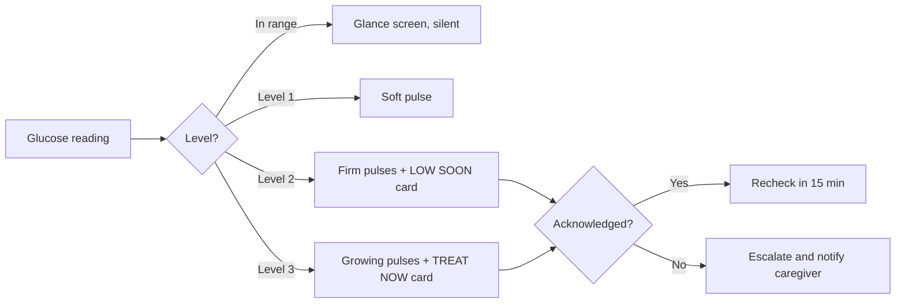

# Glucose Watch

### A smartwatch interface for glucose monitoring: clear trends, tiered urgent warnings, and readable for older adults, during exercise and while sleeping.


> **Disclaimer:** this is a student UI/UX design project, not a medical device. It does not give medical or dosing advice and has not been clinically validated. Always follow your doctor's guidance.

---

## Contents

1. [Problem statement](#problem-statement)
2. [Why this matters: the evidence](#why-this-matters-the-evidence)
3. [Who it is for](#who-it-is-for)
4. [The solution: adaptive urgency](#the-solution-adaptive-urgency)
5. [Design system](#design-system)
6. [Screens and flows](#screens-and-flows)
7. [Accessibility](#accessibility)
8. [Design process](#design-process)
9. [Repository structure](#repository-structure)
10. [Prototype and screenshots](#prototype-and-screenshots)
11. [Limitations and future work](#limitations-and-future-work)
12. [References](#references)
13. [Author](#author)

---

## Problem statement

> Design a smartwatch experience for diabetic users showing trends and urgent warnings on a tiny screen, usable during exercise and while sleeping.

**Core challenges:** tiny screen, urgency tiers, context awareness.

People with diabetes who wear a continuous glucose monitor (CGM) rely on alerts to avoid dangerous lows and highs. In practice, alarms are frequent and all feel alike, they can be ignored or slept through, and the data is hard to read while moving. A smartwatch is the most discreet, always-available place to show glucose, but its screen is tiny.

**Design question:** how can a smartwatch show glucose trends and urgent warnings clearly, at the right urgency, in daily life, during exercise and during sleep?

## Why this matters: the evidence

The problem was identified through a literature review (no user interviews were conducted; see [limitations](#limitations-and-future-work)).

| Problem | What research found |
|---|---|
| **Alarm fatigue** | In a survey of 838 adults with type 1 diabetes, heavier alarm burden was linked with ignoring alerts and overcorrecting lows. About a third of caregivers changed alarm settings to cut alarms at some times. |
| **Sleep** | Patients can sleep through current alarms, and night is when hypoglycemia is most dangerous. Waking abruptly to an alarm raised glucose by about 18 mg/dl through a stress response. |
| **Exercise** | Lows are common during and after exercise. CGM lags blood glucose (about 12 minutes on average during prolonged aerobic exercise) and is less accurate. A predictive low alert reduced time in hypoglycemia. |
| **Trust** | Mismatches with fingerstick readings and alarm fatigue are major limitations of CGM use. |
| **Existing products** | Dexcom G7 already offers an "Urgent Low Soon" alert 20 minutes ahead and quiet modes, but app reviewers report alerts that return after dismissal on the watch, limited watch-face support and no dark mode. |

Full details and sources are in [`report/02_user_research.md`](report/02_user_research.md).

## Who it is for

- **Adults and older adults with insulin-treated diabetes** who use a CGM
- **Active users** who exercise and need a glance-readable display
- **Caregivers** (parents, partners) who receive escalations
- Secondary: doctors and diabetes educators

Three proto-personas (built from the literature, to be validated with real users): *Aarav*, the night-worried student; *Meera*, the active runner; *Mr. Rao*, the older adult.

## The solution: adaptive urgency

One glance screen that changes with **urgency** and **context**.

### Four alert levels

| Level | Icon | Word | Feel | Example |
|---|---|---|---|---|
| 0 Normal | Circle | "In range" | Silent | Glucose steady |
| 1 Watch | Triangle | "Rising" / "Going down" | One soft pulse | Drifting toward limits |
| 2 Urgent | Filled triangle | "LOW SOON" | Three firm pulses | Predicted or actual low |
| 3 Critical | Exclamation | "TREAT NOW" | Growing, repeating pulses, then caregiver notified | Very low or no response |

Colour is never the only signal: every level also has an icon shape, a word and a haptic pattern.

### Three context modes

| Mode | Screen | Interaction | Alerts |
|---|---|---|---|
| **Daily** | Standard glance, 3-hour graph on swipe | Touch | Level rules above |
| **Exercise** | Huge number (120 px) and arrow only | Large targets or hardware button | Strong haptic first; shows data age and signal loss |
| **Sleep** | Dim night theme, one huge acknowledge button | One tap | Gentle haptic that ramps up, then escalates to a caregiver if no response |

### Key smart behaviours

- **Predictive alerts** warn before a low, based on direction and speed of change
- **Smart snooze** that depends on the trend, so a falling glucose cannot be snoozed for long
- **Acknowledge clears the alert on the watch**, so it does not return
- **Honest data states:** data age, signal lost, sensor warming up, with "check with fingerstick" guidance



## Design system

Two soft themes (no pure black or white, no neon) for comfort at all hours.

| Role | Day | Night |
|---|---|---|
| Background |  `#F4F1EA` |  `#0B0F14` |
| Text |  `#1F2933` |  `#E8EDF2` |
| In range |  `#1F7A4D` |  `#7FD1A8` |
| High |  `#9A5B00` |  `#F2C078` |
| Low |  `#B3261E` |  `#FF8A80` |
| Critical card |  `#9F1D1D` |  `#8E2B2B` |

**Typography** (Atkinson Hyperlegible or Roboto): number 96 px (120 px in exercise mode, 80 px on alerts), unit 24 px, titles 36 px bold, body 24 px. Nothing smaller than 24 px. Plain words only.

**Layout:** 454 x 454 px round screen, 28 px safe margin, buttons 64 to 72 px tall, one action per screen, maximum two lines of text.

Full specification: [`report/07_visual_design_and_design_system.md`](report/07_visual_design_and_design_system.md).

## Screens and flows

Every screen exists in Day and Night.

**Screens:** Glance, Trend graph, History, Settings, Watch (level 1), Urgent low (level 2), Critical (level 3), Acknowledged, Exercise mode, Sleep mode, Signal lost, Loading, Sensor warming up, Error, Low battery, Permission denied.

**Critical flows:**
1. Check status: glance, swipe to the graph and back
2. Respond to an urgent low: alert, "Got it", "Recheck in 15 min"
3. Handle a night alert: gentle alert, one big tap, caregiver escalation if no response
4. Switch mode: settings, Day / Exercise / Sleep
5. Recover from signal loss: stale screen, "Check with fingerstick"

## Accessibility

- All text meets WCAG 2.2 AA contrast (4.5:1 or more); numbers exceed 7:1 (13.08:1 Day, 16.32:1 Night)
- Never colour alone: icon shape, word and haptic for each level
- Large touch targets (48 px minimum, buttons 64 to 72 px) and a hardware-button path
- No flashing content; soft, glare-free themes
- Designed for older adults: large type, plain words, one action per screen

## Design process

Double-diamond, from discovery to reflection:

| Stage | Output |
|---|---|
| Discover | Problem definition, scope, literature and competitor research |
| Define | Personas, empathy map, user journey, information architecture |
| Ideate | Three concepts (glance-first, graph-first, adaptive urgency), scored; adaptive urgency chosen |
| Prototype | Low-fidelity wireframes, then design system, then a high-fidelity Figma prototype |
| Test | Usability tests on defined tasks and a WCAG 2.2 AA review |
| Reflect | Trade-offs, limitations, ethics, future work |

## Repository structure

```
glucose-watch-report/
├── README.md
├── report/
│   ├── 00_abstract.md
│   ├── 01_problem_definition_and_scope.md
│   ├── 02_user_research.md
│   ├── 03_personas_and_empathy_map.md
│   ├── 04_user_journey_and_information_architecture.md
│   ├── 05_ideation_and_concept_selection.md
│   ├── 06_low_fidelity_wireframes.md
│   ├── 07_visual_design_and_design_system.md
│   ├── 08_high_fidelity_interactive_prototype.md
│   ├── 09_usability_testing_and_iteration.md
│   ├── 10_design_rationale_reflection_future_work.md
│   ├── 11_references.md
│   └── 12_appendix.md
├── prompts/
│   └── figma_build_prompts.md
└── assets/            sketches, wireframes, screenshots
```


## Limitations and future work

- **Not a medical device;** thresholds and escalation timing need clinical review.
- **Research is literature-based.** No user interviews were conducted, so the personas are proto-personas to be validated with real users.
- Haptic patterns cannot be fully tested in a clickable prototype.
- Context detection (exercise, sleep) is assumed to be available from watch sensors.
- The older-adult readability assumptions need testing with older users.

**Next steps:** user interviews and testing with older adults and caregivers, personalised alert timing, better context detection using heart rate and sleep stage, clinical review, voice acknowledgement, and a companion phone app.

## References

Selected sources (full IEEE list in [`report/11_references.md`](report/11_references.md)):

1. "The emotional burden and behavioral impacts of alarms and alerts across the spectrum of diabetes technology use," *JMIR Diabetes*, 2026. https://diabetes.jmir.org/2026/1/e97122
2. "Alarm fatigue and sleep deprivation," *Diabetes Care for Children & Young People*. https://diabetesonthenet.com/diabetes-care-children-young-people/alarm-fatigue-and-sleep-deprivation/
3. "Duration of nocturnal hypoglycemia before seizures," *Diabetes Care*, 2008. https://pmc.ncbi.nlm.nih.gov/articles/PMC2571056
4. "Hidden in the night: wearable sleep assessment of nocturnal hypoglycaemia in type 1 diabetes," medRxiv, 2026. https://www.medrxiv.org/content/10.64898/2026.01.22.26344161.full.pdf
5. Dexcom, "Dexcom G7: How it works." https://dexcom.com/en-ca/dexcom-g7-how-it-works
6. W3C, "Web Content Accessibility Guidelines (WCAG) 2.2." https://www.w3.org/TR/WCAG22/

## Author

**[D Lokesh]**, [1EP24CS033], Dept. of Computer Science & Engineering, East Point College of Engineering & Technology
Course: Advanced UI/UX, V Semester B.E. | Guide: Mr Prasanth, Assistant Professor, Dept. of CSE

---

*Made as an academic design project. Feedback is welcome through issues.*
